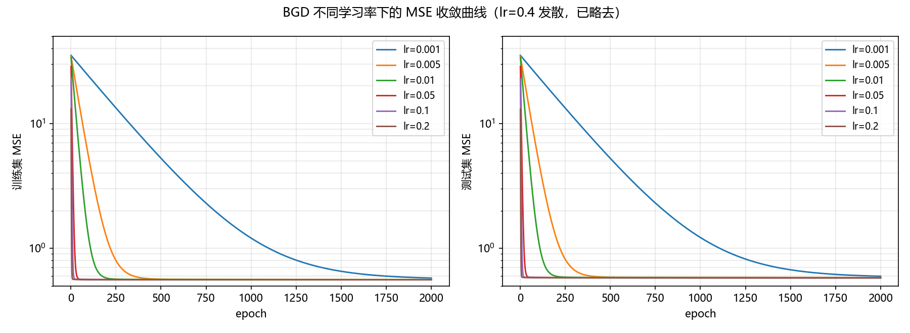
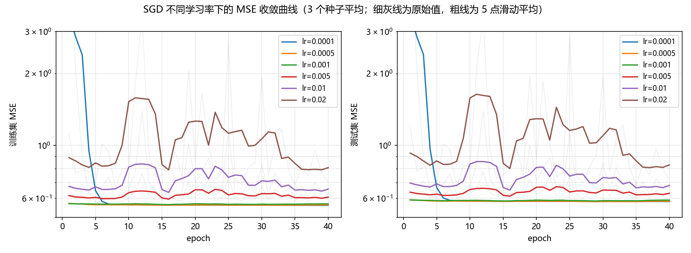
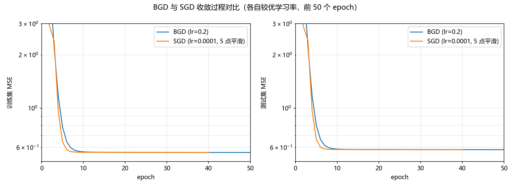
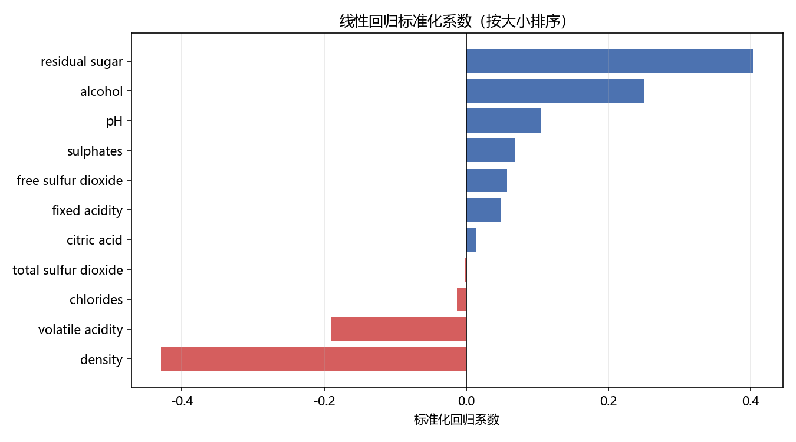
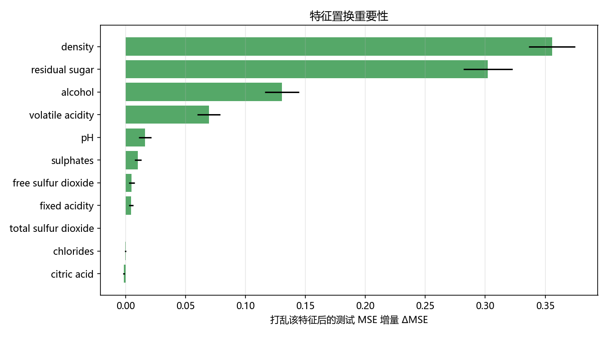
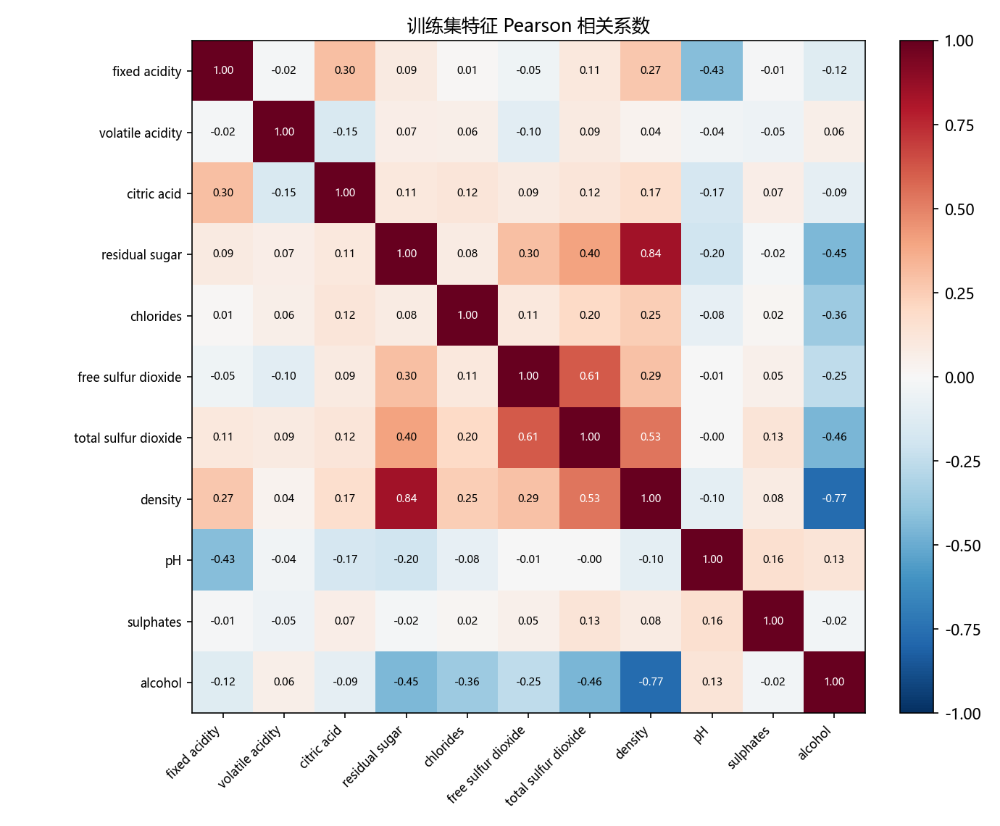
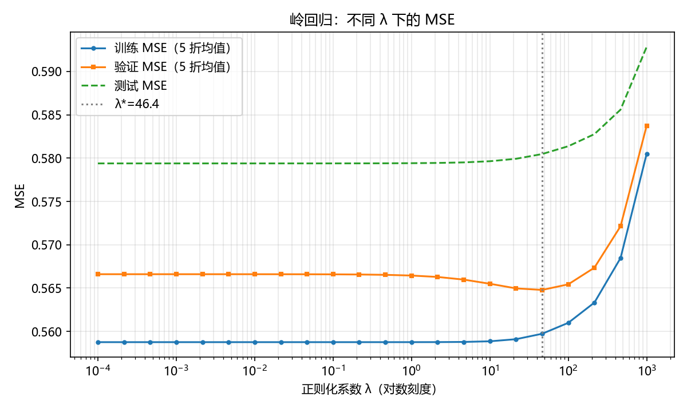
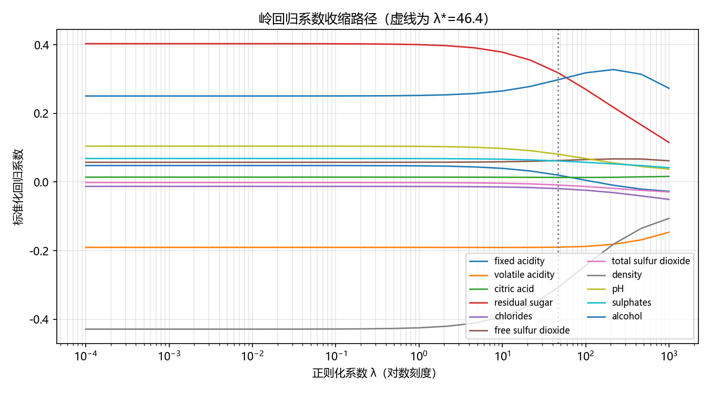

# 实验二：白葡萄酒质量回归（实验报告）

学院：计算机科学与网络空间安全学院     姓名：李梦涛     学号：2412483

## 一、实验概述

**题目**：白葡萄酒质量回归

**实验要求**：

| 级别  | 要求                                                                                               |
| --- | ------------------------------------------------------------------------------------------------ |
| 初级  | 4:1 划分训练/测试集并做预处理；手写线性回归，分别用 BGD 与 SGD 优化；输出训练/测试 MSE 并绘制收敛曲线；对比不同学习率并选择较优值                      |
| 中级  | 比较 BGD 与 SGD 的误差、收敛速度与稳定性；分析至少 3 个特征对质量预测的影响；用训练集 Pearson 系数选出最相关的一对特征，做“保留 / 去掉其一”的系数与 MSE 对照实验 |
| 高级  | 手写岭回归（L2 正则化），报告平均训练误差与平均测试误差，并注明偏置项约定                                                           |

**开发环境**：Python 3.14.0、NumPy 2.4.1、pandas 3.0.0、scikit-learn 1.9.1（仅用于数据划分、标准化、评估指标与对比验证）、Matplotlib 3.10.8；

**代码仓库**：[KaGaMi9999/nku-2026-machinelearning](https://github.com/KaGaMi9999/nku-2026-machinelearning)

---

## 二、数据集预处理及划分

### 2.1 数据概况

数据文件为 `winequality-white.csv`，字段以分号 `;` 分隔。读取结果：**4898 行 × 12 列**，前 11 列为理化指标，最后一列 `quality` 为质量评分（3~9 的整数）。**无缺失值**，不做去重。

quality 分布高度不平衡：

| 评分  | 3   | 4   | 5    | 6    | 7   | 8   | 9   |
| --- | ---:| ---:| ----:| ----:| ---:| ---:| ---:|
| 样本数 | 20  | 163 | 1457 | 2198 | 880 | 175 | 5   |

评分均值 5.878、标准差 0.886，绝大多数样本集中在 5~7 分，3 分与 9 分极少，这直接限制了回归模型可达到的精度。

各特征量纲差异显著（`density` 标准差仅 0.003，`total sulfur dioxide` 标准差达 42.5），且 `residual sugar`、`chlorides` 等呈明显右偏（偏度分别为 1.08、5.02）：

| 特征                   | 均值       | 标准差     | 最小值    | 最大值    |
| -------------------- | --------:| -------:| ------:| ------:|
| fixed acidity        | 6.8548   | 0.8438  | 3.80   | 14.20  |
| volatile acidity     | 0.2782   | 0.1008  | 0.08   | 1.10   |
| citric acid          | 0.3342   | 0.1210  | 0.00   | 1.66   |
| residual sugar       | 6.3914   | 5.0715  | 0.60   | 65.80  |
| chlorides            | 0.0458   | 0.0218  | 0.009  | 0.346  |
| free sulfur dioxide  | 35.3081  | 17.0054 | 2.00   | 289.00 |
| total sulfur dioxide | 138.3607 | 42.4937 | 9.00   | 440.00 |
| density              | 0.9940   | 0.0030  | 0.9871 | 1.0390 |
| pH                   | 3.1883   | 0.1510  | 2.72   | 3.82   |
| sulphates            | 0.4898   | 0.1141  | 0.22   | 1.08   |
| alcohol              | 10.5143  | 1.2305  | 8.00   | 14.20  |

### 2.2 预处理

1. **读取**：`pd.read_csv(..., sep=";")`，全部 11 个特征均为数值型，无需编码。
2. **标准化（z-score）**：对每个特征 `x' = (x − μ) / σ`，其中 **μ、σ 只由训练集计算**，再原样作用于测试集，避免信息泄漏。标准化是梯度下降能正常收敛的前提：若直接用原始尺度，`density` 方向的梯度比 `total sulfur dioxide` 小 4 个数量级，学习率要么在硫方向发散、要么在密度方向几乎不动。
3. **偏置项**：在标准化特征后拼接全 1 列，记特征维数 `n = 12`，模型写作 `h_θ(x) = θᵀ[x; 1]`。

### 2.3 训练/测试划分

使用 `train_test_split(test_size=0.2, stratify=y, random_state=42)`，按 `quality` 分层抽样，得到 **训练集 3918 条、测试集 980 条**，两者评分分布基本一致：

| 评分  | 3   | 4   | 5    | 6    | 7   | 8   | 9   |
| --- | ---:| ---:| ----:| ----:| ---:| ---:| ---:|
| 训练集 | 16  | 130 | 1166 | 1758 | 704 | 140 | 4   |
| 测试集 | 4   | 33  | 291  | 440  | 176 | 35  | 1   |

不分层时，9 分样本（共 5 条）有较大概率全部落入训练集，此时测试集将失去该评分档，因此进行分层抽样，分层抽样同时保证每个评分档在测试集中都有代表。

---

## 三、实现思路与关键代码

### 3.1 目标函数与梯度

采用均方误差作为目标函数（m 为样本数）：

```
J(θ) = (1/m) · Σ_i (h_θ(x_i) − y_i)²
∇J(θ) = (2/m) · Xᵀ(Xθ − y)
```

BGD 每轮使用全部训练样本计算梯度；SGD 每轮先随机打乱样本，再对每个样本用其单样本梯度 `2(h_θ(x_i) − y_i)·x_i` 更新一次参数。一次完整遍历称为一个 epoch。BGD 与 SGD 的初始参数均取 `θ = 0`。

### 3.2 关键代码

BGD 核心（`codes/linreg_bgd_sgd.py`）：

```python
for epoch in range(epochs):
    grad = (2.0 / m) * (Xb.T @ (Xb @ theta - y))
    theta = theta - lr * grad
    train_hist[epoch] = mse(Xb, y, theta)
    test_hist[epoch] = mse(Xb_te, y_te, theta)
```

SGD 核心：

```python
for epoch in range(epochs):
    for i in rng.permutation(m):
        xi = Xb[i]
        err = xi @ theta - y[i]
        theta = theta - lr * 2.0 * err * xi
    train_hist[epoch] = mse(Xb, y, theta)   # 每个 epoch 末在全集上评估
```

岭回归解析解（`codes/ridge.py`，偏置项不惩罚）：

```python
xm, ym = X.mean(axis=0), y.mean()
Xc, yc = X - xm, y - ym
w = np.linalg.solve(Xc.T @ Xc + lam * np.eye(X.shape[1]), Xc.T @ yc)
b = ym - xm @ w          # 等价于对 [X,1] 加惩罚掩码 [1,...,1,0]
```

**偏置项约定**：只惩罚 11 个特征的系数，偏置项 b 不参与惩罚。~~~~

### 3.3 超参数设置

| 项目        | 设置                                     |
| --------- | -------------------------------------- |
| BGD 学习率   | 0.001、0.005、0.01、0.05、0.1、0.2、0.4      |
| BGD epoch | 2000                                   |
| SGD 学习率   | 1e-4、5e-4、1e-3、5e-3、1e-2、2e-2          |
| SGD epoch | 40（每个学习率取 3 个随机种子的平均，曲线做 5 点滑动平均）      |
| 岭回归 λ     | 1e-4 ~ 1e3 共 22 个对数等距取值，训练集内 5 折交叉验证选择 |
| 评价指标      | MSE、R²                                 |

---

## 四、实验结果与分析

### 4.1 BGD：学习率的影响

| 学习率   | 训练 MSE   | 测试 MSE   | 表现              |
| ----- | --------:| --------:| --------------- |
| 0.001 | 0.577219 | 0.597243 | 2000 epoch 内未收敛 |
| 0.005 | 0.561368 | 0.582272 | 接近最优            |
| 0.01  | 0.560246 | 0.580975 | 接近最优            |
| 0.05  | 0.559460 | 0.579419 | 收敛              |
| 0.1   | 0.559460 | 0.579388 | 收敛              |
| 0.2   | 0.559460 | 0.579387 | 收敛（最快）          |
| 0.4   | NaN      | NaN      | 发散              |



**分析**：目标函数是二次型，Hessian 为 `(2/m)XᵀX`，其最大特征值 `L ≈ 6.46`，理论上学习率需满足 `lr < 2/L ≈ 0.31` 才不发散，`lr < 1/L ≈ 0.155` 时参数在各方向上都不会过冲。实验结果与之吻合：0.2 仍能收敛（损失单调下降，但参数在陡峭方向上会来回摆动），0.4 直接发散（第 1 个 epoch 后 MSE 溢出）；学习率越小收敛越慢，0.001 在 2000 轮后仍未到达最优点。综合收敛速度与稳定性，**BGD 选择 lr = 0.2**（0.05~0.2 的最终 MSE 基本相同，说明均已充分收敛）。

### 4.2 SGD：学习率的影响

| 学习率  | 训练 MSE   | 测试 MSE（3 种子）      |
| ---- | --------:| -----------------:|
| 1e-4 | 0.560696 | 0.581577 ± 0.0001 |
| 5e-4 | 0.562448 | 0.583584 ± 0.0011 |
| 1e-3 | 0.568547 | 0.590618 ± 0.0043 |
| 5e-3 | 0.600217 | 0.623247 ± 0.0182 |
| 1e-2 | 0.627098 | 0.649043 ± 0.0212 |
| 2e-2 | 0.698541 | 0.719646 ± 0.0726 |



**分析**：SGD 的曲线呈现明显的锯齿波动——每次更新只用一个样本，梯度是真实梯度的无偏但高方差估计，参数在最优点附近持续抖动。学习率越大，抖动幅度与种子间方差越大：lr=2e-2 时测试 MSE 的种子标准差已达 0.073，而 lr=1e-4 仅 0.0001。因此 SGD 的“较优学习率”是**收敛速度与噪声水平之间的折中**：本实验中 1e-4 的最终误差最低，但收敛较慢；若要求更快收敛，5e-4~1e-3 更合适。

### 4.3 BGD 与 SGD 对比

| 模型           | 训练 MSE   | 测试 MSE       | 收敛所需 epoch |
| ------------ | --------:| ------------:| ----------:|
| BGD（lr=0.2）  | 0.559460 | **0.579387** | 约 11       |
| SGD（lr=1e-4） | 0.560696 | 0.581577     | 约 7        |
| 正规方程闭式解      | 0.559460 | 0.579387     | —          |

（收敛 epoch 的判定标准：训练 MSE 首次降到 0.565，即最优值 0.55946 的 1% 以内。）



**分析**：

- **误差**：两者最终测试 MSE 仅差 0.0022（0.38%），都收敛到线性模型的最优解附近，BGD 略优。SGD 的常数学习率使其无法精确停在最优点，存在约 0.001 的噪声底。
- **收敛速度**：按 epoch 计 SGD 更快，但一个 SGD epoch 包含 3918 次参数更新，计算代价远高于一次 BGD 更新；若按参数更新次数比较，BGD 反而更“省”。这体现了 SGD 的优势在于单步代价低、适合大规模数据，而非总更新次数少。
- **稳定性**：BGD 曲线单调平滑；SGD 曲线每轮都在波动，且对学习率、随机种子敏感（同学习率下种子间 MSE 标准差最大可达 0.07）。

### 4.4 实现正确性校验

| 模型                              | 训练 MSE   | 测试 MSE   |
| ------------------------------- | --------:| --------:|
| 手写正规方程闭式解                       | 0.559460 | 0.579387 |
| sklearn `LinearRegression`（仅对比） | 0.559460 | 0.579387 |
| 手写 BGD（lr=0.2）                  | 0.559460 | 0.579387 |

手写闭式解与 sklearn 的系数最大绝对差为 `4.8e-14`，手写 BGD 与正规方程的系数最大绝对差为 `6.4e-9`，说明手写的目标函数、梯度与更新公式均正确。测试集 R² = 0.2619，即 11 个理化指标只能解释约 26% 的质量评分方差，说明线性模型在该数据上的解释能力有限，这是因为评分是主观的，离散的且差异性较大的特性。

### 4.5 特征影响分析

标准化后的回归系数（可直接比较相对影响大小）：

| 特征               | 系数          | 特征                   | 系数      |
| ---------------- | -----------:| -------------------- | -------:|
| density          | **−0.4291** | sulphates            | 0.0685  |
| residual sugar   | **0.4034**  | free sulfur dioxide  | 0.0574  |
| alcohol          | **0.2508**  | fixed acidity        | 0.0481  |
| volatile acidity | **−0.1907** | citric acid          | 0.0142  |
| pH               | 0.1047      | chlorides            | −0.0128 |
|                  |             | total sulfur dioxide | −0.0015 |



考虑到特征之间存在相关性，系数大小可能被“分摊”，进一步做了**置换重要性**实验：在测试集上随机打乱某一特征 30 次，统计测试 MSE 的平均增量。

| 特征                   | ΔMSE 均值 | 标准差    |
| -------------------- | -------:| ------:|
| density              | 0.3557  | 0.0193 |
| residual sugar       | 0.3022  | 0.0205 |
| alcohol              | 0.1305  | 0.0143 |
| volatile acidity     | 0.0695  | 0.0096 |
| pH                   | 0.0161  | 0.0053 |
| sulphates            | 0.0104  | 0.0029 |
| free sulfur dioxide  | 0.0051  | 0.0024 |
| fixed acidity        | 0.0046  | 0.0020 |
| total sulfur dioxide | 0.0001  | 0.0001 |
| chlorides            | −0.0002 | 0.0006 |
| citric acid          | −0.0014 | 0.0006 |



**分析**：

- **alcohol（酒精度，正相关）**：系数 +0.2508，置换后 MSE 增加 0.13。酒精是影响口感与评分的最主要正向因素之一，酒精度越高评分倾向越高。
- **volatile acidity（挥发性酸，负相关）**：系数 −0.1907，置换后 MSE 增加 0.069。挥发性酸过高会带来醋味，是典型的负面指标。
- **density（密度）与 residual sugar（残糖）**：两者系数绝对值最大且符号相反（−0.4291 与 +0.4034），置换重要性也最高。但它们高度相关（见 4.6），系数的“分摊”使单个系数不能单独解释为因果效应；从机理上，残糖高会提高密度，而密度高本身对应酒精/糖分的组合，因此两者的正负号需结合共线性理解。
- **chlorides、citric acid** 的置换重要性为负：打乱它们后测试 MSE 反而略降，说明在当前线性模型中这两个特征主要贡献噪声，可考虑剔除。

### 4.6 相关特征与共线性实验

训练集 Pearson 相关系数热力图：



相关性最强的一对特征是 **residual sugar 与 density，r = 0.8399**（其次是 free/total sulfur dioxide，r = 0.61；density 与 alcohol，r = −0.77）。对这对特征做对照实验：

| 模型                | residual sugar 系数 | density 系数  | 训练 MSE   | 测试 MSE   |
| ----------------- | -----------------:| -----------:| --------:| --------:|
| 保留两者              | 0.4034            | −0.4291     | 0.559460 | 0.579387 |
| 去掉 residual sugar | —                 | **+0.1301** | 0.572983 | 0.592689 |
| 去掉 density        | **0.1307**        | —           | 0.566476 | 0.586910 |

**分析**：

- **系数极不稳定**：两者同时保留时符号一正一负、量级相当；只保留 density 时其系数由 −0.43 变成 **+0.13（符号翻转）**；只保留 residual sugar 时其系数由 0.40 降到 0.13。这正是多重共线性的典型表现——两个高度相关的特征共同解释同一部分方差，模型无法唯一分配权重。
- **其他系数也被牵连**：去掉 density 后，alcohol 的系数从 0.2508 增大到 0.4467，fixed acidity 从 +0.0481 变为 −0.0456，pH 从 0.1047 降到 0.0283。共线性不只影响这对特征本身，其他系数也会被牵连。
- **预测效果影响较小**：三种模型的测试 MSE 分别为 0.5794、0.5927、0.5869，最多只差 2.3%。说明存在共线性时，**系数不可解释，但预测值仍相对稳定**。

### 4.7 岭回归（L2 正则化，解析法）

在训练集内做 5 折交叉验证选择 λ（λ 从 1e-4 到 1e3 共 22 个对数等距取值）：

| λ              | 平均训练 MSE     | 平均验证 MSE     |
| --------------:| ------------:| ------------:|
| 1e-4           | 0.558761     | 0.566602     |
| 4.6e-3         | 0.558761     | 0.566601     |
| 0.464          | 0.558761     | 0.566528     |
| 21.54          | 0.559102     | 0.564966     |
| **46.42（λ\*）** | **0.559729** | **0.564786** |
| 1000           | 0.580508     | 0.583748     |



- **最优 λ = 46.42**：此时 **平均训练MSE 0.559729、平均验证MSE 0.564786**（5 折验证 MSE 标准差 0.019406，主要来自各折样本量差异）。
- 在全部训练集上重训后：训练 MSE = 0.560084，**测试 MSE = 0.580468**；而 λ=0（普通最小二乘）为 0.559460 / 0.579387。岭回归的测试误差比 OLS 高约 0.0011（0.19%）。



**系数变化**（λ* 与 OLS 对比）：

| 特征               | OLS (λ=0) | Ridge (λ\*) | 特征                   | OLS (λ=0) | Ridge (λ\*) |
| ---------------- | ---------:| -----------:| -------------------- | ---------:| -----------:|
| density          | −0.4291   | −0.3082     | sulphates            | 0.0685    | 0.0615      |
| residual sugar   | 0.4034    | 0.3188      | free sulfur dioxide  | 0.0574    | 0.0626      |
| alcohol          | 0.2508    | 0.2980      | fixed acidity        | 0.0481    | 0.0202      |
| volatile acidity | −0.1907   | −0.1902     | citric acid          | 0.0142    | 0.0133      |
| pH               | 0.1047    | 0.0813      | chlorides            | −0.0128   | −0.0192     |
|                  |           |             | total sulfur dioxide | −0.0015   | −0.0086     |

系数向量的 L2 范数从 **0.6839 降到 0.5805（−15%）**，其中共线性最强的 density 与 residual sugar 收缩幅度最大（分别约 28% 与 21%），而 alcohol 的系数反而略有上升（0.2508 → 0.2980）；偏置项在两模型中均为 5.8780（不参与惩罚）。

**分析**：本数据中 λ 从 1e-4 到约 10 的区间内验证误差几乎不变（曲线极平），说明特征矩阵虽然条件数不大（约 146），但共线性使某些方向上的估计方差偏高；岭回归通过收缩降低了方差，但由于该数据噪声占主导、真实信号较弱，偏差的增加抵消了方差的收益，因此测试误差没有改善，λ 增大到 100 以上后误差迅速上升（欠拟合）。在本实验中岭回归的主要作用是**稳定系数**，对提高预测精度作用有限。

---

## 五、总结

1. **初级**： BGD/SGD 线性回归，测试集 MSE 分别为 0.5794 与 0.5816；BGD 在 lr=0.2 时约 11 个 epoch 将训练 MSE 降到最优值的 1% 以内，lr=0.4 发散（与理论上界 2/L≈0.31 吻合）；SGD 在 lr=1e-4 时噪声最小。
2. **中级**：BGD 平滑但单步代价高，SGD 收敛快但方差大；影响最大的特征是 density、residual sugar、alcohol 与 volatile acidity；residual sugar 与 density 的相关系数达 0.84，去掉任一个都会导致系数符号/量级剧变，而测试 MSE 仅变化 1%~2.3%，是典型的多重共线性。
3. **高级**：解析法岭回归（偏置不惩罚）5 折交叉验证选出 λ*=46.42，平均训练误差 0.559729、平均验证误差 0.564786，测试 MSE 0.580468；系数范数缩小 15%，但没有带来预测精度提升，说明本数据中正则化的作用是稳定系数而对提高精度作用有限。

**局限与改进**：质量评分是有序离散值且分布极不平衡，线性回归 + MSE 难以刻画；后续可尝试特征变换（对数/多项式）、有序回归或树模型；SGD 可加入学习率衰减以降低噪声底。

---

## 附录：文件结构

```
Lab2/
├── codes/
│   ├── linreg_bgd_sgd.py     # 初级+中级：BGD/SGD、学习率对比、闭式解校验
│   ├── feature_analysis.py   # 中级：系数、置换重要性、相关性、共线性实验
│   ├── ridge.py              # 高级：解析法岭回归 + 5 折 CV 选 λ
│   └── requirements.txt      # 依赖清单
├── reports/
│   ├── lab2_report.md        # 本报告
│   ├── lab2_report.pdf       # PDF 版
│   ├── linreg_outputs.txt    # BGD/SGD 运行日志
│   ├── feature_outputs.txt   # 特征分析运行日志
│   ├── ridge_outputs.txt     # 岭回归运行日志
│   └── figs/                 # 全部实验图
└── winequality-white.csv     # 原始数据
```

复现方式：`cd Lab2 && python codes/linreg_bgd_sgd.py && python codes/feature_analysis.py && python codes/ridge.py`
